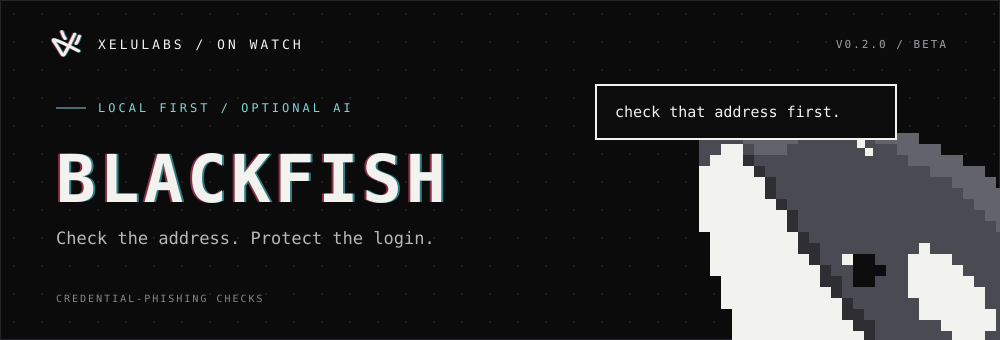
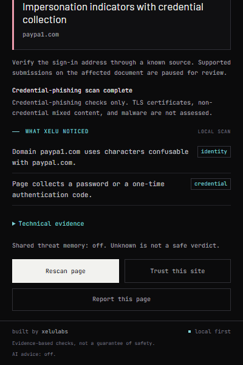

# BlackFish



<p align="center">
  <strong>Credential-phishing checks. Local first. Xelu on watch.</strong><br>
  <sub>v0.2.0 personal beta · Chrome Manifest V3 · Optional AI</sub>
</p>

<p align="center">
  <a href="#get-started">Get started</a> ·
  <a href="#what-the-warnings-mean">Warnings</a> ·
  <a href="PRIVACY.md">Privacy</a> ·
  <a href="#development">Development</a> ·
  <a href="CONTRIBUTING.md">Contributing</a>
</p>

BlackFish is a Chrome extension from [xelulabs](https://github.com/RafBlack/xelulabs) that looks for signs of login and credential phishing. It checks the address and page locally, explains what it finds, and pauses supported credential submissions when stronger evidence calls for a second look.

Local protection works offline, without an account or AI provider. This is a personal beta installed from source; Web Store distribution is not configured in this repository. Shared threat memory requires a separately deployed service and an invitation. Managed AI remains behind its evaluation gate.

## What BlackFish does

- **Checks the address early.** Detects protected-brand lookalikes, confusable domains, and misleading brand subdomains using explicit domain boundaries and approved brand identities.
- **Checks credential collection.** Inspects visible password and explicit sign-in-code fields, form destinations, page branding, and displayed link destinations, including discovered open shadow roots and embedded frames.
- **Explains before you decide.** Xelu gives concrete findings and recommended actions in the popup, page warnings, and submission dialog. Canceling never authorizes a later submission; overrides apply once to the inspected form and destination.
- **Keeps evidence stable.** Repeated scans do not stack points. Removing evidence updates the assessment, and unrelated frames cannot combine into a stronger finding.
- **Leaves optional services optional.** Personal AI, shared reputation, reporting, and managed AI start disabled. Local detection keeps running when those services are unavailable.

<p align="center">
  
  <br><sub>Actual extension interface, captured on a controlled test fixture.</sub>
</p>

## Get started

You need **desktop Chrome 116 or newer** and **Node.js 20 or newer** to build the extension. Backend development has separate requirements in its [setup guide](backend/README.md).

```sh
git clone https://github.com/RafBlack/blackfish.git
cd blackfish
npm ci
npm run build
```

Already have a checkout? Run the install and build commands from the folder containing `package.json` and `manifest.json`.

1. Open `chrome://extensions` in Chrome.
2. Enable **Developer mode**, then choose **Load unpacked**.
3. Select the generated **`blackfish/dist`** folder.
4. Pin BlackFish to the toolbar and refresh any tabs already open.

Local checks are on by default. Open the popup for the current page's findings, use **Rescan page** after a change, or open **Settings** to configure protected domains and optional services.

After updating the source, run `npm run build`, reload BlackFish in `chrome://extensions`, and refresh existing web tabs. The repository root is also loadable after building; `dist/` is the self-contained extension package. Executable code, dependencies, fonts, and artwork are bundled locally.

## What the warnings mean

| Finding | What BlackFish does |
| --- | --- |
| Impersonation indicators with credential collection in the same document | Warns and pauses supported credential submissions for a deliberate one-time decision. |
| Insecure password or explicit sign-in-code collection | Warns and pauses supported submissions on HTTP pages, HTTP destinations, or unsupported destination schemes. This is a transport finding, not proof of phishing. |
| Domain or branding mismatch | Asks you to verify the address. A title or branding claim alone cannot authorize a submission interruption. |
| Cross-site HTTPS credential destination | Shows a passive popup notice. Legitimate SSO can do this; the destination alone triggers no page warning or interruption. |
| Fresh, reviewer-confirmed threat match | Prioritizes a confirmed-phishing warning, independently of the local index. Reputation alone does not interrupt submission or block page loading. |
| No strong indicators, or a partial/failed/unavailable scan | Reports the observed state and coverage. None of these establishes that the page is safe. |

The experimental numeric index is collapsed under **Technical evidence**. Its weights are hand-set: it is not a phishing probability, CVSS rating, or calibrated risk score. Warnings and submission decisions follow explicit evidence policies. See the [full policy, weights, and primary sources](evaluation/SCORING.md).

## Privacy and controls

Local analysis needs no network service. Optional features share data only after configuration and consent:

| Feature | Default | Data shared when enabled |
| --- | --- | --- |
| Personal or local AI | Off | Top-document hostname, matched rule IDs, and credential-field presence, sent to your configured provider. |
| Shared threat memory | Off | Hostname and a hash of the exact address, preserving its query and excluding its fragment. Hashing is not anonymity. |
| Page reports | Off | The exact address and detection metadata, only after a separate preview and confirmation. Reports enter human review. |
| XeluLabs-managed AI | Off; evaluation-gated | Hostname, rule IDs, and credential presence; curated, reviewed examples may be included. |

AI receives no raw URLs, page text, titles, screenshots, field values, or credentials. It provides advice only and cannot change scores, interrupt submissions, or grant approval. Personal AI supports xAI HTTPS or HTTP localhost/127.0.0.1 OpenAI-compatible endpoints; arbitrary remote endpoints are not supported.

**Trust this site** pauses protection for that exact origin, including its embedded frames. Removing trust in Settings resumes checks on open pages. Adding a **protected domain** helps detect impersonation; it does not grant trust. You can clear local threat and AI caches without deleting settings or credentials.

Shared-service requests exclude trusted origins, incognito pages, private IP literals, localhost, and intranet names. Required permissions are `storage`, `webNavigation`, and `alarms`; HTTP(S) content scripts provide automatic page analysis. Optional network access is requested for the configured supported endpoint or exact Workers service origin. No provider key or installation token is bundled.

Read the [privacy policy](PRIVACY.md) for storage, retention, provider visibility, and consent details. The [backend guide](backend/README.md) covers the separately operated invited service; the extension build never deploys it.

## Scope and current limits

BlackFish focuses on **credential theft**. It does not assess TLS certificates, non-credential mixed content, malware, wallet draining, or every link on a page. AMTSO's agreed phishing-test URL is unsupported; BadSSL's connection tests do not measure this detector's phishing coverage. Use the [manual test matrix](evaluation/MANUAL-TESTS.md) to choose relevant checks.

Direct native `form.submit()`, JavaScript credential exfiltration, earlier page handlers, and closed shadow roots can bypass supported scanning or interception. Large pages have explicit scan bounds, and browser-internal pages and some viewers cannot be scanned. Same-site phishing without a recognized identity claim and new attack styles may be missed.

A hostile page can hide or remove in-page warnings. Use the extension popup and toolbar as the authoritative interface. Independent real-world accuracy, AI benefit, and some minimum-version/navigation lifecycle scenarios still need validation; public distribution also needs a working public privacy contact and matching store disclosures.

## Development

The extension uses JavaScript ES modules, Chrome APIs, HTML/CSS, esbuild, `tldts`, and Punycode.js. No framework or development server is required. Build, load unpacked, and reload to iterate; no dev-server or lint command is configured.

| Command | Purpose |
| --- | --- |
| `npm run build` | Bundle the extension into `dist/`. |
| `npm test` | Run the Node unit regressions. |
| `npx playwright install chromium` | Install the browser used by the integration suite. |
| `npm run test:browser` | Build and run controlled Chromium extension tests. |
| `npm run evaluate` | Measure the 300 synthetic regression fixtures. |
| `npm run evaluate:branding` | Compare the disabled form-branding candidate against the current policy. |
| `npm run check` | Run unit tests, browser tests, and the synthetic evaluation. |

Browser tests fulfill page requests from local fixtures and never submit real credentials to live phishing sites. Screenshots and local logs are written to ignored `test-results/` files.

The [current synthetic report](evaluation/latest-report.json) records alerts on 100 phishing fixtures, no alerts or interruptions on 200 benign fixtures, and 20 passive SSO destination notices. These correlated scenarios verify regressions; they do **not** establish production accuracy. The [form-branding candidate](evaluation/form-branding-report.json) remains disabled because it also adds benign alerts. See the [evaluation guide](evaluation/README.md) for methodology and offline AI comparison.

### Project map

```text
background/   Document state, badges, settings, and optional service coordination
content/      Page scanning, credential guard, and Xelu warnings
lib/          Evidence policy, domain heuristics, storage, and AI contracts
popup/        Toolbar interface
options/      Settings and consent controls
ui/           Shared theme and branding
backend/      Optional Workers + D1 + Workers AI service
tests/        Unit and browser regressions
evaluation/   Synthetic fixtures, measurements, and detection policy
```

For implementation details, see the [detection reference](docs/DETECTION.md). If Chrome reports **service-worker status 15** or **Failed to resolve module specifier `tldts`**, rebuild and reload the generated package; Chrome must load bundled code, not raw npm imports.

## Feedback

[Use the issue chooser](https://github.com/RafBlack/BlackFish/issues/new/choose) for reproducible bugs, detection feedback, and feature requests. Include the Chrome version, BlackFish version, scan status, and rule IDs. Use a controlled example when possible; remove credentials, private URLs, query tokens, and account details before sharing. A reported page does not become a confirmed threat automatically.

The [contribution guide](CONTRIBUTING.md) covers local checks and private reporting for vulnerabilities in BlackFish. Maintainers can find About text, topics, and the social preview in the [repository setup guide](docs/REPOSITORY.md).

Built by **[xelulabs](https://github.com/RafBlack/xelulabs)**. Xelu's original artwork, the mark, and packaged fonts are documented in the [visual system](DESIGN.md) and [asset provenance](assets/SOURCE.md).
